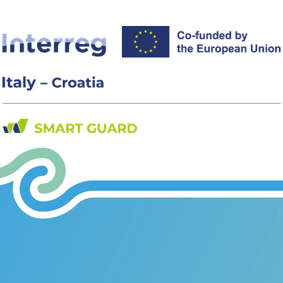
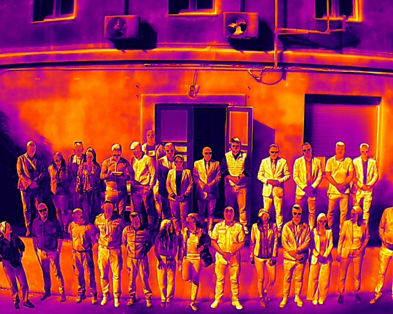
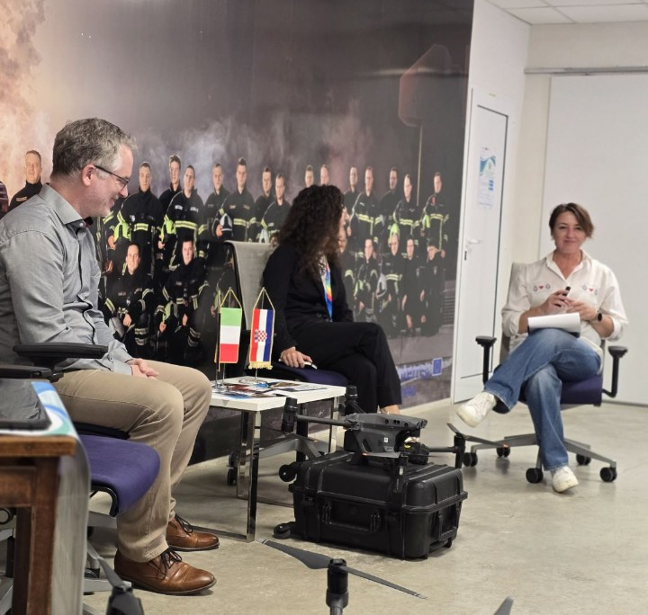
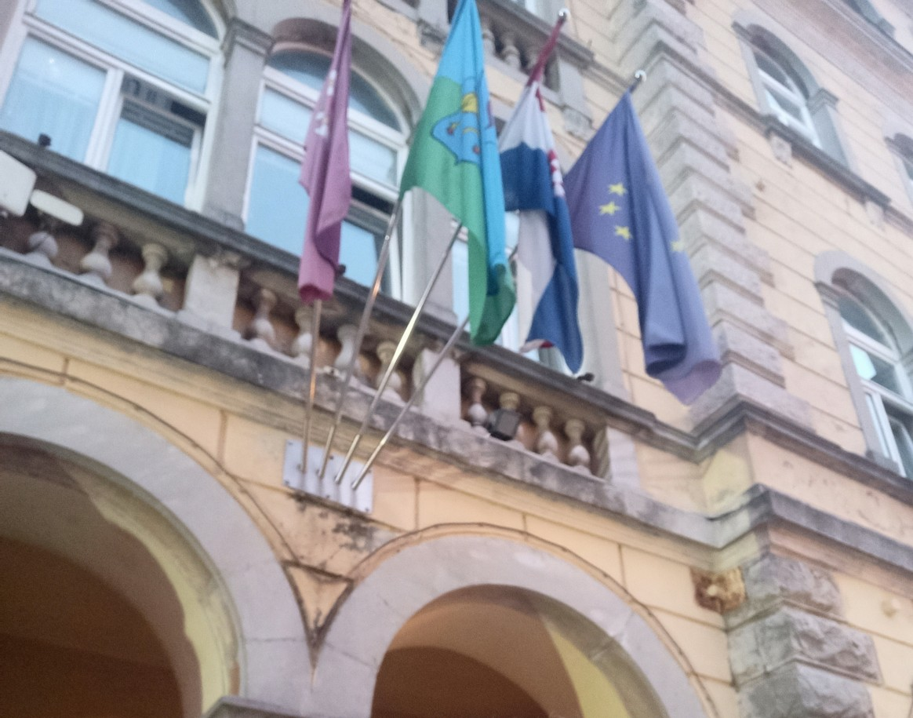
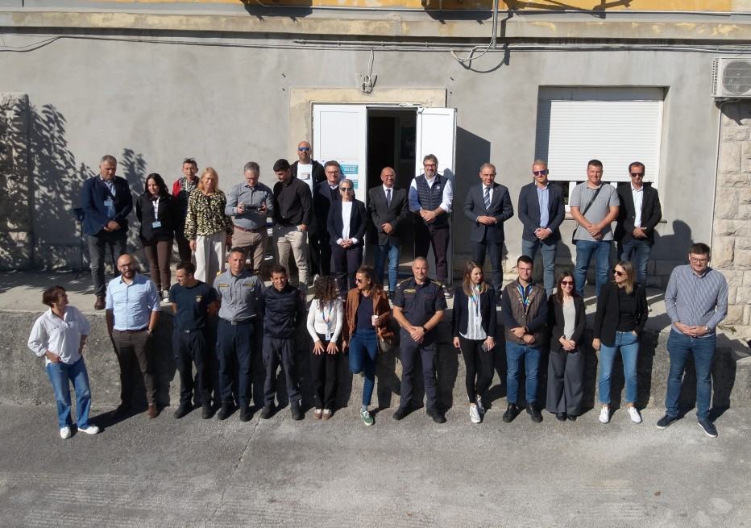
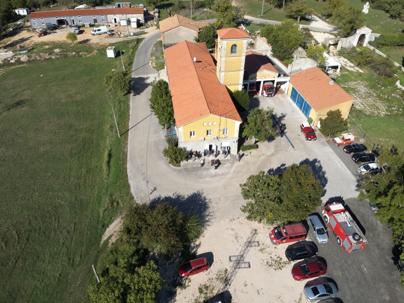
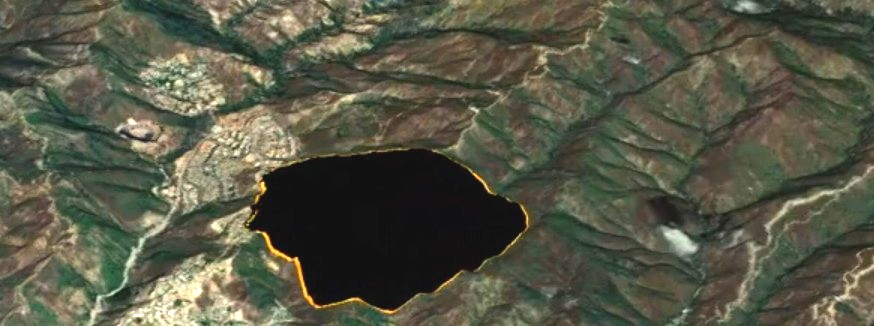
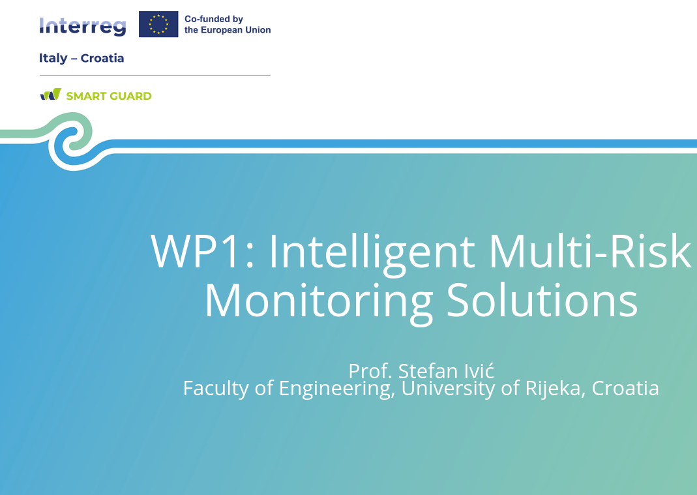

The kick-off meeting of the Interreg SMART GUARD project was held in Labin on October 15–16. The meeting was hosted and organized by the City of Labin, the project’s lead partner, in cooperation with the Public Fire Brigade Labin, an associated partner.

Our team is a project partner responsible for providing scientific and technical expertise in simulation, analysis, and risk assessment related to wildfires and urban heat island phenomena.

More info on the project is avaliable at [lab's SMART GUARD projcet page](../../projects/smart_guard).

 




