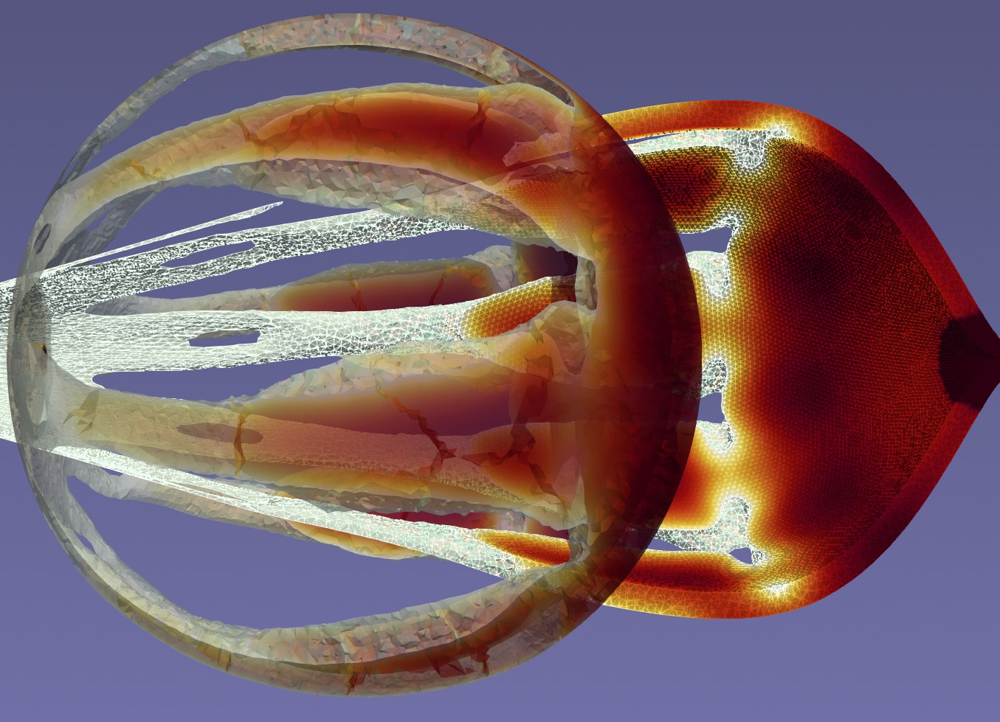
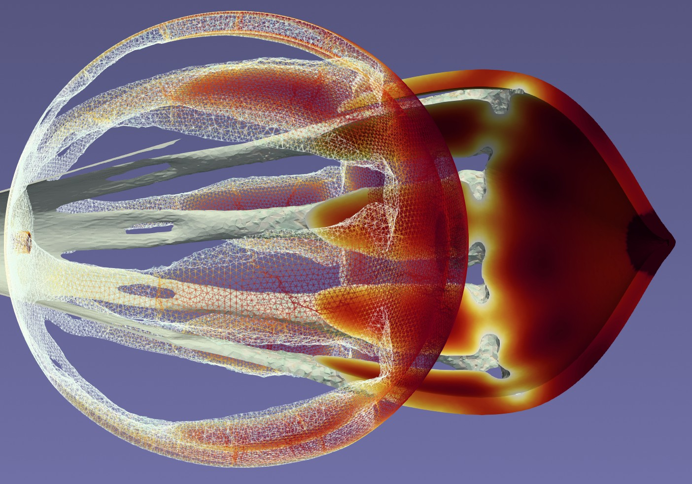
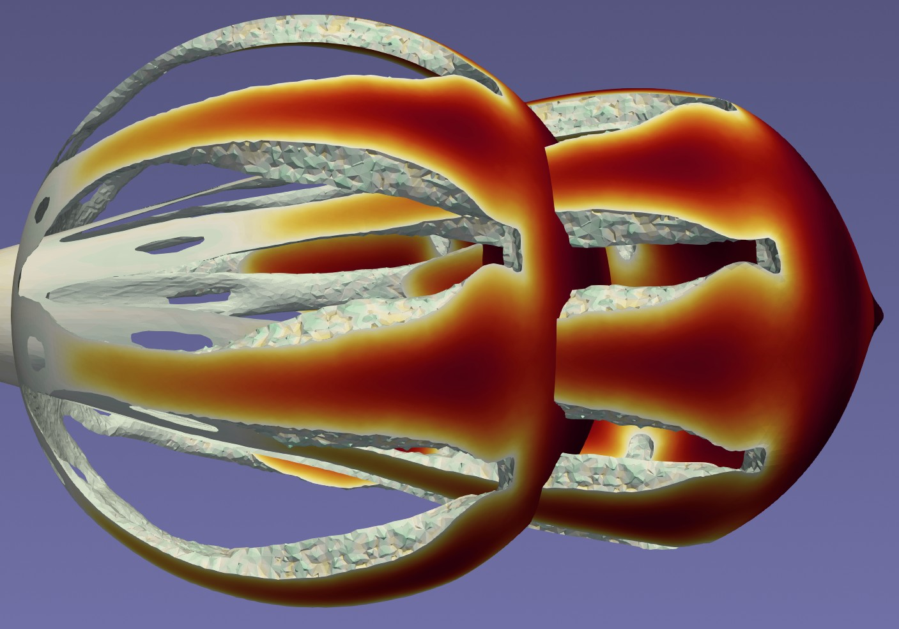
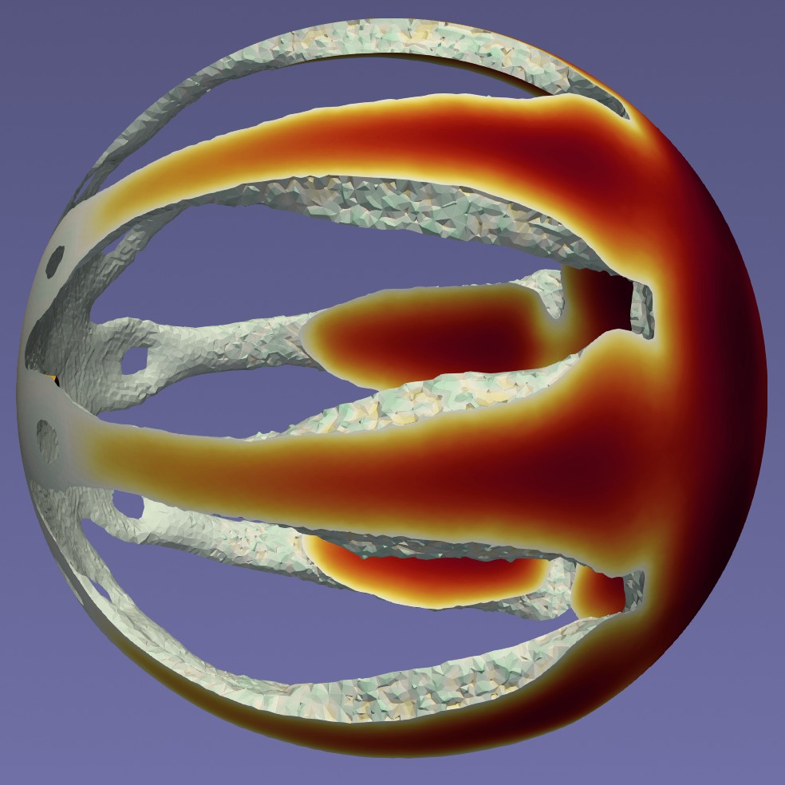

**Croatian Science Foundation research project**

Understanding sea surface flow is essential for tracking pollution, search-and-rescue operations, and climate modelling. Reconstruction of sea surface flow fields from sparse measurements obtained through the deployment of GPS-equipped buoys (drifters) is effective but limited by their uncontrolled motion. Drifters are naturally aggregated under the influence of currents, consequently leaving large areas sparsely sampled or unobserved, reducing the relevance of measurement information. To overcome these limitations, we propose active robotic drifters capable of maintaining and adjusting their position through onboard propulsion. These drifters operate in two modes: a passive mode for velocity measurements and an active mode for repositioning. Our work builds on a previously developed data-driven flow-fit model that reconstructs velocity fields directly from measurements collected by (passive) Lagrangian drifters.

Effective positioning strategies will be developed to coordinate a swarm of active drifters to improve the spatial coverage of the monitored region. This work will build on our existing flow meta-model and ergodic control methods. Because the reconstruction framework enables local estimation of velocity field uncertainty, we will extend this approach to weighted Voronoi coverage, directing drifters toward areas with higher prediction error. Strategies for drifter repositioning will consider technical constraints such as autonomy, communication, balancing measuring and relocation states, and energy-efficient trajectory planning. The developed strategy for drifter repositioning will be evaluated in realistic simulation environments.

To adapt to different operational needs, a shape-changing drifter will be designed. During measurement, to accurately follow sea currents, it needs to maintain high drag. During relocation, the drifter's body transforms into a streamlined shape for efficient transit. This will be achieved through a flexible, compliant 3D printed structure that allows switching between these two configurations, alongside with foldable kirigami-inspired underwater drogue. The drifter prototype and its components will be experimentally evaluated through laboratory testing and in real field trials at sea.

PI is prof. **Stefan Ivić**.

Team members:
- **Luka Lanča**
- **Karlo Jakac**
- **Ante Sikirica**
- **Ivan Markovinović**




