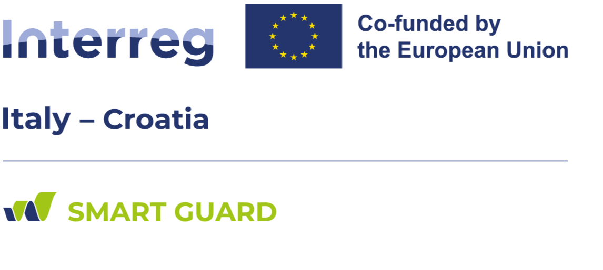

**Interreg Italy - Croatia project**

<!--  -->

[Official SMART GUARD project web page](http://)

SMART GUARD addresses two interconnected territorial challenges compromising climate resilience
across the Italy-Croatia cooperation area: insufficient climate monitoring systems and fragmented
civil protection coordination. Current monitoring systems operate in isolation, creating information
silos that prevent comprehensive risk assessment, while the absence of standardised methodologies
and harmonised data collection protocols limits climate risk management effectiveness.
Simultaneously, fragmented civil protection systems lack standardised procedures and interoperable
communication systems, creating barriers to effective cross-border collaboration between Italian and
Croatian emergency services, local authorities, and community-based organisations during climate
emergencies.

SMART GUARD overall objective is to develop and implement integrated digital solutions for
environmental risk management in the Italy-Croatia cooperation area, focusing on wildfire and urban
heat island risk monitoring. The project aims to provide emergency professionals and citizens with
actionable climate risk information through pilot actions, community and youth engagement, training
programmes and cross-border simulation exercises to strengthen emergency response and cross-
border resilience. The expected changes include transforming reactive emergency response
approaches into proactive, data-driven climate risk management systems whilst establishing
sustainable cross-border institutional cooperation frameworks.

The project main outputs are jointly developed digital solutions for intelligent multi-risk monitoring,
vulnerability registry and community support systems strategy and cross-border climate risk
management strategy with operational protocols. The main beneficiaries are local authorities who
will benefit from enhanced capabilities for climate risk management and coordinated emergency
response protocols, emergency professionals and civil protection services who will gain access to
real-time environmental data and joint training programmes, and citizens who will receive proactive
climate risk information and participate in community-based risk management initiatives.
No less important is the introduction of "Digital Rangers" programme which involves a group of 100
young volunteers aged 16-25 who will serve as environmental guardians, equipped with
environmental monitoring competencies and emergency management knowledge gained through
residential training camps alternating between Italy and Croatia.

Cross-border cooperation between Italy and Croatia represents an essential component of SMART
GUARD, providing fundamental added value that cannot be achieved through individual national
approaches. Environmental challenges such as wildfire risks and urban heat island effects extend
beyond administrative borders, requiring shared risk assessment methodologies and coordinated
prevention strategies. Individual national approaches would result in duplicated efforts and
incompatible data collection systems, preventing comprehensive risk assessment capabilities. Cross-
border cooperation enables standardised risk assessment methodologies and optimal utilisation of
financial resources and technical expertise.

SMART GUARD proposes an integrated cross-border digital ecosystem representing a paradigm shift
from traditional fragmented emergency response approaches to a unified, proactive climate risk
management system. The main innovation is the development of a jointly operated digital platform
simultaneously monitoring multiple environmental risks across administrative borders. This AI-
powered system integrates real-time data from IoT sensors, weather stations, and thermal drones
strategically placed in different pilot sites across the cross-border area, to generate predictive
analytics for wildfire risk assessment and urban heat island monitoring. Unlike existing monitoring
systems operating in isolation within national frameworks, this platform creates a unified cross-
border information ecosystem enabling coordinated risk assessment and response strategies.
Another important innovation is the introduction of pilot operational support centres functioning
according to graduated activation protocols, transforming from information points during normal
conditions to comprehensive emergency response centres and climate shelters for vulnerable
citizens during climate emergencies.

